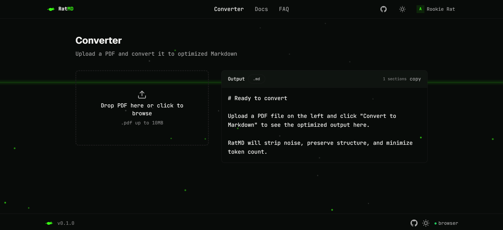
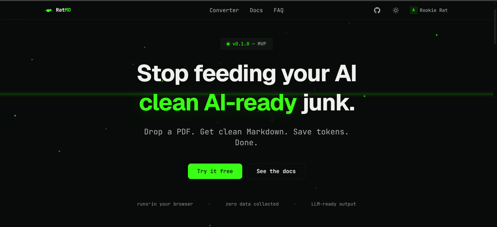
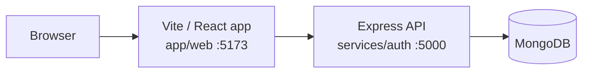

# RatMD

**PDF → Markdown, optimized for AI** — clean, token-efficient Markdown for LLM and RAG workflows.

RatMD turns PDFs into structured Markdown in the browser. It is built for developers working with LLMs, RAG pipelines, and AI workflows who need clean input without uploading documents. Conversion works without an account; sign in to save conversion history and view savings.

[](https://react.dev)
[](LICENSE)

[Live Demo](TODO_LIVE_URL) · [Report an issue](https://github.com/abdrahman-dev/RatMD/issues)

## Screenshots


*Converter — client-side PDF to clean, token-efficient Markdown.*


*Landing page — what a new visitor sees first.*

<!-- TODO: dashboard screenshot missing — add docs/screenshots/dashboard.png and replace this line -->
**TODO:** Dashboard screenshot pending — expected at `docs/screenshots/dashboard.png` (not yet added).

## Features

- **Client-side PDF parsing** — text extraction in the browser with `pdfjs-dist`; the PDF file never leaves your device.
- **Markdown output** — structured, token-efficient Markdown with download and clipboard copy.
- **Token estimation** — `js-tiktoken` `cl100k_base` counts with before/after comparison.
- **Auth** — register, login, logout, and token refresh with httpOnly JWT cookies.
- **Conversion history** — signed-in users can save conversion records.
- **Dashboard** — total savings, conversion count, and paginated history.

## Tech Stack

| Layer | Technology |
| --- | --- |
| Frontend | React 19, TypeScript 6, Vite 8, TailwindCSS 4, Zustand 5, React Router 7, Framer Motion 12 |
| Backend | Node.js 20+, Express 5, Zod 4, JWT (`jsonwebtoken`) + httpOnly cookies |
| PDF / tokens | `pdfjs-dist` 5, `js-tiktoken` 1 (`cl100k_base`) |
| Database | MongoDB 6+ with Mongoose 9 |
| Tooling | ESLint, `nodemon`, Docker + Nginx (static frontend) |

## Architecture



PDF parsing runs fully in the browser. The Express API is only used for accounts, conversion history, and stats — it never receives the PDF.

## Getting Started

Prerequisites: Node.js 20+, npm 10+, and MongoDB (local or Atlas) for accounts/history. The converter itself runs without a backend.

```bash
git clone https://github.com/abdrahman-dev/RatMD.git
cd RatMD

# Backend (terminal 1)
cd services/auth
cp .env.example .env
npm install
npm run dev

# Frontend (terminal 2)
cd ../web
cp .env.example .env
npm install
npm run dev
```

Frontend dev server: `http://localhost:5173`. API dev server: `http://localhost:5000`. In dev, Vite proxies `/api` to `http://localhost:5000`, so the default `VITE_API_URL=/api` needs no CORS setup. Fill in the backend secrets in `services/auth/.env` (see below); generate them with:

```bash
node -e "console.log(require('crypto').randomBytes(48).toString('hex'))"
```

Scripts: `npm run dev` (both), `npm run build` + `npm run typecheck` + `npm run lint` (`app/web`), `npm start` (`services/auth`).

Docker (`docker compose up -d --build`) serves the built frontend only — it does not start the API or database.

## Environment Variables

### Backend — `services/auth/.env.example`

| Variable | Required | Default / constraint | Purpose |
| --- | --- | --- | --- |
| `PORT` | Yes | number, 1–65535 (example `5000`) | HTTP port |
| `MONGODB_URL` | Yes | non-empty | MongoDB connection string |
| `ACCESS_TOKEN_SECRET` | Yes | min 32 characters | Signs access tokens |
| `REFRESH_TOKEN_SECRET` | Yes | min 32 characters | Signs refresh tokens |
| `ENCRYPTION_SECRET` | Yes | min 32 characters | Encrypts stored OpenRouter keys |
| `NODE_ENV` | No | `development` (one of `development\|production\|test`) | Runtime mode |
| `ALLOWED_ORIGINS` | No | `http://localhost:5173` — comma-separated list | CORS allowlist (credentials enabled) |
| `TRUST_PROXY` | No | `0` — non-negative integer (hops) | Set `>0` behind a proxy so rate limiting sees real client IP |
| `LLM_BASE_URL` | No | `https://openrouter.ai/api/v1` | OpenRouter base URL (optional enhancement) |
| `LLM_MODEL` | No | `openai/gpt-4o-mini` | OpenRouter model (optional enhancement) |

### Frontend — `app/web/.env.example`

| Variable | Required | Default | Purpose |
| --- | --- | --- | --- |
| `VITE_API_URL` | No | `/api` | Backend API base URL; Vite proxies `/api` → `http://localhost:5000` in dev |

## Deployment

1. **MongoDB Atlas** — create a cluster and a database user; copy the `mongodb+srv://` connection string (replace `<password>` with the database user's password). Set it as `MONGODB_URL` on the backend.

2. **Backend on Render** — New Web Service, root directory `services/auth`, build command `npm install`, start command `npm start`. Set these environment variables (generate secrets with `crypto.randomBytes(48)` — never reuse local values):

   | Variable | Secret? | Value |
   | --- | --- | --- |
   | `MONGODB_URL` | Secret-ish (contains credentials) | Atlas connection string |
   | `ACCESS_TOKEN_SECRET` | Yes | 48-byte random hex |
   | `REFRESH_TOKEN_SECRET` | Yes | 48-byte random hex |
   | `ENCRYPTION_SECRET` | Yes | 48-byte random hex |
   | `PORT` | No | `5000` (or Render's default `PORT`) |
   | `NODE_ENV` | No | `production` |
   | `ALLOWED_ORIGINS` | No | `https://<your-frontend>.vercel.app` |
   | `TRUST_PROXY` | No | `2` |
   | `LLM_BASE_URL` | No | `https://openrouter.ai/api/v1` (optional) |
   | `LLM_MODEL` | No | `openai/gpt-4o-mini` (optional) |

3. **Frontend on Vercel** — New Project, root directory `app/web`, default Vite build. Set `VITE_API_URL` to `/api` (the API is reached through the Vercel rewrite). Replace `BACKEND_URL_PLACEHOLDER` in `app/web/vercel.json` with your Render URL (`https://<your-backend>.onrender.com`) — the `/api/:path*` rewrite must stay first, above the SPA fallback.

   Re-deploy Vercel after updating `vercel.json`. Generate all secrets with `node -e "console.log(require('crypto').randomBytes(48).toString('hex'))"` and never commit them.

## API Endpoints

Base path is `/api`. History and profile routes require a valid access-token cookie; see `services/auth/README.md` for the full auth flow and models.

| Method | Path | Auth required | Description |
| --- | --- | --- | --- |
| GET | `/api/auth/` | No | Health check |
| POST | `/api/auth/register` | No | Create a new account |
| POST | `/api/auth/login` | No | Login, sets auth cookies |
| POST | `/api/auth/logout` | No | Revoke refresh token, clear cookies |
| POST | `/api/auth/refresh` | No | Rotate refresh token, issue new access token |
| GET | `/api/auth/me` | Yes | Current user |
| POST | `/api/auth/change-password` | Yes | Change password |
| POST | `/api/conversions/save` | Yes | Save a conversion record |
| POST | `/api/conversions/enhance` | Yes | Optional LLM cleanup of already-extracted Markdown (never the PDF) |
| GET | `/api/conversions/history` | Yes | Paginated history (`?page=1&limit=10`) |
| GET | `/api/conversions/stats` | Yes | Tokens saved, conversions, savings %, rank |
| GET | `/api/profile` | Yes | Get user profile |
| PUT | `/api/profile` | Yes | Update profile fields |
| PUT | `/api/profile/llm-key` | Yes | Store or update an encrypted OpenRouter key |
| GET | `/api/community/leaderboard` | No | Top 20 users by tokens saved |
| PUT | `/api/community/avatar` | Yes | Update avatar |
| GET | `/api/community/profile/:userId` | No | Public profile |

## Project Structure

```text
RatMD/
├── app/web/                # React SPA (Vite, TypeScript, Tailwind)
│   └── src/                # router, stores, pages, features, lib (api/pdf/tokenizer)
├── services/auth/          # Express + MongoDB API
│   ├── app.js              # entry, CORS, trust-proxy, route mounts
│   ├── routes/             # auth, conversions, profile, community
│   ├── controllers/        # request handlers + Zod validation
│   ├── model/              # Mongoose models + connectDB
│   └── config/             # env validation (Zod), cookie options
├── Dockerfile / docker-compose.yml / nginx.conf  # static frontend image (port 3000)
└── README.md
```

Details: [app/web](app/web/README.md) · [services/auth](services/auth/README.md)

## Known Limitations

- Heading detection is heuristic (font-size ratios), so unusual PDFs can get the wrong hierarchy.
- Text-only: no image or table extraction, no OCR for scanned PDFs.
- 10 MB web limit; token savings vary by PDF (typically ~30–60% for heavily formatted docs).
- Cookies use `sameSite: 'strict'`; frontends on a different site than the API will need a same-site setup.
- Docker serves the frontend only; the API and database need to run separately (or point `VITE_API_URL` at a deployed API).

## Roadmap (future)

- **Go converter service** — a Go service for server-side PDF→Markdown conversion (future plan; no Go service exists yet).
- OCR for scanned PDFs, image extraction, public conversion API, automated tests, leaderboard UI.

## License

[MIT](LICENSE)
