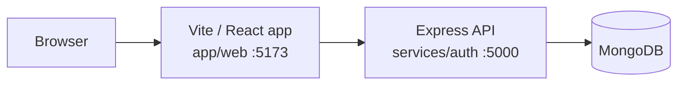

# RatMD

**PDF to Markdown, optimized for AI** — clean, token-efficient Markdown for LLM and RAG workflows.

RatMD turns PDFs into structured Markdown entirely in the browser. It is built for developers working with LLMs, RAG pipelines, and AI workflows who need clean input without uploading documents. Conversion works without an account; sign in to save conversion history and track savings.

[Live Demo](TODO_LIVE_URL)

## Screenshots


*Converter — client-side PDF to token-efficient Markdown.*


*Landing page — what a new visitor sees first.*

## Features

- **Client-side PDF parsing** — text extraction in the browser with `pdfjs-dist`; the PDF never leaves your device.
- **Markdown output** — structured Markdown with download and clipboard copy.
- **Token estimation** — `cl100k_base` counts via `js-tiktoken`, with before/after comparison.
- **Auth** — register, login, logout, and token refresh using httpOnly JWT cookies.
- **Conversion history** — signed-in users can save conversion records.
- **Dashboard** — total tokens saved, conversion count, and paginated history.

## Tech Stack

| Layer | Technology |
| --- | --- |
| Frontend | React 19, TypeScript 6, Vite 8, TailwindCSS 4, Zustand 5, React Router 7, Framer Motion 12 |
| Backend | Node.js 20+, Express 5, Zod 4, JWT (`jsonwebtoken`) + httpOnly cookies |
| PDF / tokens | `pdfjs-dist` 5, `js-tiktoken` 1 (`cl100k_base`) |
| Database | MongoDB 6+ with Mongoose 9 |
| Tooling | ESLint, `nodemon`, Docker + Nginx (static frontend) |

## Architecture



PDF parsing runs fully in the browser. The Express API handles accounts, conversion history, and stats — it never receives the PDF.

## Quick Start

Prerequisites: Node.js 20+, npm 10+, and MongoDB (local or Atlas) for accounts/history. The converter works without a backend.

```bash
git clone https://github.com/abdrahman-dev/RatMD.git
cd RatMD

# Backend (terminal 1)
cd services/auth
cp .env.example .env    # fill in the three secrets
npm install
npm run dev             # http://localhost:5000

# Frontend (terminal 2)
cd ../web
cp .env.example .env    # optional — defaults to /api, proxied to :5000 in dev
npm install
npm run dev             # http://localhost:5173
```

Generate secrets with:

```bash
node -e "console.log(require('crypto').randomBytes(48).toString('hex'))"
```

Scripts: `npm run dev` (both packages), `npm run build`, `npm run typecheck`, `npm run lint` (`app/web`), `npm start` (`services/auth`).

## Environment Variables

### Backend — `services/auth/.env.example`

| Variable | Required | Default / constraint | Purpose |
| --- | --- | --- | --- |
| `PORT` | Yes | number, 1–65535 (example `5000`) | HTTP port |
| `MONGODB_URL` | Yes | non-empty | MongoDB connection string |
| `ACCESS_TOKEN_SECRET` | Yes | min 32 characters | Signs access tokens |
| `REFRESH_TOKEN_SECRET` | Yes | min 32 characters | Signs refresh tokens |
| `ENCRYPTION_SECRET` | Yes | min 32 characters | Encrypts stored OpenRouter keys |
| `NODE_ENV` | No | `development` | `development`, `production`, or `test` |
| `ALLOWED_ORIGINS` | No | `http://localhost:5173` | Comma-separated CORS allowlist (credentials enabled) |
| `TRUST_PROXY` | No | `0` | Proxy hop count for client IP behind a proxy |
| `LLM_BASE_URL` | No | `https://openrouter.ai/api/v1` | OpenRouter base URL (optional enhancement) |
| `LLM_MODEL` | No | `openai/gpt-4o-mini` | OpenRouter model (optional enhancement) |

### Frontend — `app/web/.env.example`

| Variable | Required | Default | Purpose |
| --- | --- | --- | --- |
| `VITE_API_URL` | No | `/api` | API base URL; Vite proxies `/api` → `localhost:5000` in dev |

## API Endpoints

Base path is `/api`. History and profile routes require a valid access-token cookie; see [services/auth](services/auth/README.md) for models and the full auth flow.

| Method | Path | Auth | Description |
| --- | --- | --- | --- |
| GET | `/api/auth/` | No | Health check |
| POST | `/api/auth/register` | No | Create a new account |
| POST | `/api/auth/login` | No | Login, sets auth cookies |
| POST | `/api/auth/logout` | No | Revoke refresh token, clear cookies |
| POST | `/api/auth/refresh` | No | Rotate refresh token, issue new access token |
| GET | `/api/auth/me` | Yes | Current user |
| POST | `/api/auth/change-password` | Yes | Change password |
| POST | `/api/conversions/save` | Yes | Save a conversion record |
| POST | `/api/conversions/enhance` | Yes | Optional LLM cleanup of extracted Markdown (never the PDF) |
| GET | `/api/conversions/history` | Yes | Paginated history (`?page=1&limit=10`, `limit` ≤ 100) |
| GET | `/api/conversions/stats` | Yes | Tokens saved, conversions, savings %, rank |
| GET | `/api/profile` | Yes | Get user profile |
| PUT | `/api/profile` | Yes | Update profile fields |
| PUT | `/api/profile/llm-key` | Yes | Store or update the encrypted OpenRouter key |
| GET | `/api/community/leaderboard` | No | Top 20 users by tokens saved |
| PUT | `/api/community/avatar` | Yes | Update avatar |
| GET | `/api/community/profile/:userId` | No | Public profile |

## Deployment

1. **MongoDB Atlas** — create a cluster and database user; copy the `mongodb+srv://` connection string. Set it as `MONGODB_URL`.
2. **Backend on Render** — new Web Service, root directory `services/auth`, build `npm install`, start `npm start`. Set `MONGODB_URL`, `ACCESS_TOKEN_SECRET`, `REFRESH_TOKEN_SECRET`, `ENCRYPTION_SECRET` (all secrets, generate with `crypto.randomBytes(48)` — never reuse local values), plus `NODE_ENV=production`, `ALLOWED_ORIGINS=https://<your-frontend>.vercel.app`, `TRUST_PROXY=2`. Optionally `LLM_BASE_URL` and `LLM_MODEL`.
3. **Frontend on Vercel** — new project, root directory `app/web`, default Vite build. Set `VITE_API_URL=/api`. Replace `BACKEND_URL_PLACEHOLDER` in `app/web/vercel.json` with your Render URL (`https://<your-backend>.onrender.com`); the `/api/:path*` rewrite must stay first, above the SPA fallback. Re-deploy after editing `vercel.json`.

## Limitations

- Heading detection is heuristic (font-size ratios); unusual PDFs can produce an incorrect hierarchy.
- Text-only extraction: no image or table extraction, no OCR for scanned PDFs.
- 10 MB web limit; token savings vary by document type (typically ~30–60% for heavily formatted PDFs).
- Cookies use `sameSite: 'strict'`; a frontend on a different site than the API will not send them.
- Docker serves the frontend only; run the API and database separately, or point `VITE_API_URL` at a deployed API.

## Roadmap

- Go converter service — a Go service for server-side PDF → Markdown conversion (future; none exists yet)
- OCR for scanned PDFs, image extraction, public conversion API, automated tests, leaderboard UI

## License

[MIT](LICENSE)
